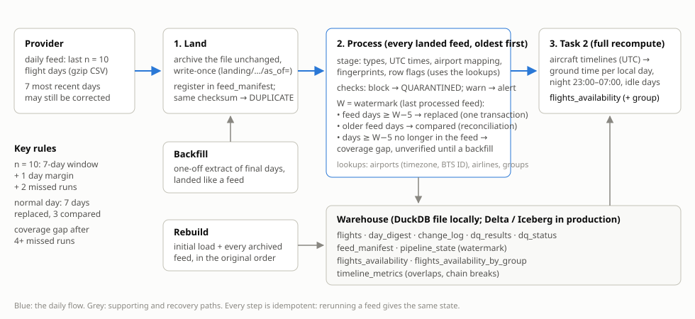
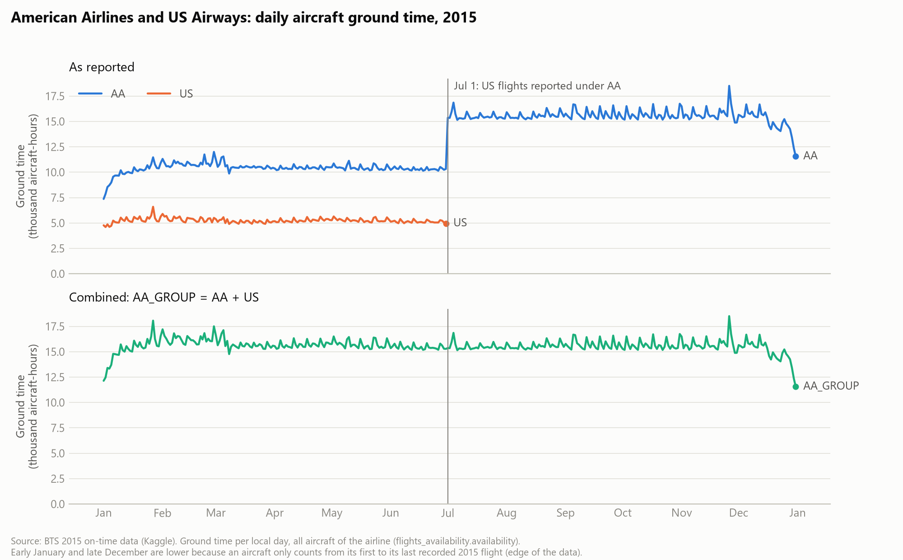

# Daily flights pipeline and aircraft availability

**Aegean data engineering exercise** · Georgios Tsakiridis · 2015 US flights (BTS on-time data, Kaggle "flight-delays")

## Summary

**What is delivered**

- A working pipeline in Python and DuckDB (`python -m aegean …`) that stores the 2015 flights and updates them daily from a rolling feed. Each feed is archived as delivered, checked, and loaded by replacing whole days. Days that are already final are compared, never overwritten.
- `flights_availability` for the whole of 2015: ground time per airline and local day, the part between 23:00 and 07:00, and a count of aircraft that were idle all day. It comes as CSV and Parquet, with a per-airline-group view.
- A simulated provider and an end-to-end demo: 35 daily feeds with 11 failure scenarios. All checks pass, and the result equals the original file for every final day.
- Reports (data profiling, data quality, sanity checks), a chart, 64 tests, and an Airflow sketch of the production setup.

**Key decisions**

| Question | Decision | Why, in one line |
|---|---|---|
| n (days per feed) | **10** (cautious alternative: 14) | The 7-day correction window, 1 day of margin at the edge, and 2 missed runs (a weekend with nobody on hand). Days 8–10 give a free reconciliation check. |
| How days are updated | Replace whole days; compare the final ones | Handles corrections, additions and deletions alike, doesn't depend on a perfect key, and is safe to rerun. |
| How the job is split | **Land** (archive the file) → **Process** (check, load) | A processing failure never loses data, so n only has to cover failures to fetch the feed. |
| What "a day" means | Local day of the airport where the aircraft is parked | This matches the dataset's flight day and the local 23:00–07:00 window. 18.8% of flights fall on another UTC date. |
| Night | The night hours inside day D (00:00–07:00 + 23:00–24:00) | The literal reading of the brief. Each day is self-contained, and night ≤ availability always holds. |
| Which aircraft count | Every aircraft on every day between its first and last recorded flight | "Not flying" is not flying, whatever the reason. Idle days are exposed as a neutral count, not classified. |

**Key limitations**

- **Flights missing from the dataset.** The data has only US domestic flights, so international, charter and ferry flights are invisible and those aircraft look idle. Availability is likely overstated for the network airlines (AA, UA, DL).
- **Recent days change for ~3 weeks** as absent aircraft reappear.
- **The simulator's correction rates are invented.**

---

## 1. How to run

See `README.md`. In short: `pip install -r requirements.txt`, put the Kaggle files in `data/raw/`, then run `python -m aegean build-lookups`, `full-run`, `report`, `profile` and `demo`, and `python -m pytest`. Every number in section 2 is recomputed by `python -m aegean profile` (Appendix A).

## 2. What the data showed

The analysis came before the design, and most design decisions below trace back to one of these findings.

| Topic | Finding | Consequence |
|---|---|---|
| Size | 5,819,079 rows, 365 days, 14 airlines, 4,897 aircraft. 10,068–17,574 flights a day (median 16,379). Saturdays are ~19% lower. Thanksgiving is the minimum. | Volume checks compare with the **same weekday**, and holidays are listed. |
| Row key | The given key has **2 duplicate groups**: AA 803 on Aug 29 (STT → CLT and STT → SJU, both cancelled, no tail number) and EV 5660 on Oct 16 (SHV → IAH diverted, then a separate CLL → IAH continuation). Adding origin and destination makes it unique. | Whole days are replaced instead of merging row by row. The extended key is used for fingerprints and change logs. |
| October airports | All 486,165 October rows use 5-digit BTS airport IDs instead of IATA codes. | Mapped with the official BTS lookups, with 4 ambiguous matches resolved and 1 renamed airport (PBI) resolved from the flight data. Validated: 307 of 307 IDs mapped one-to-one, 99.49% of October flights on routes also flown in September. |
| Clock values | HHMM text; midnight is always `2400`, never `0000`. The clock wraps when a delay passes midnight: 17,537 flights depart on the next day, delays run up to 1,988 min (33 h), and early departures just after midnight wrap backwards. | Times are never parsed on their own. Actual departure = scheduled date + scheduled time + delay, which holds for 100% of normal flights. |
| Timezones | Every clock value is local to its airport. For about half of all flights, subtracting the local times is wrong by whole hours (JFK 06:27 → LAX 09:51 looks like 204 min, but `ELAPSED_TIME` is 384). | Each airport gets an IANA timezone from its coordinates. `airports.csv` has **two coordinate errors**: GUM's longitude and PPG's latitude have the wrong sign and fall in the ocean, which would put Guam 20 h off. Both are fixed, and a rule now rejects ocean zones. The conversion reproduces `ELAPSED_TIME` for 99.9985% of normal flights; the ~90 exceptions are mostly on the two daylight saving nights. |
| Consistency | Every rule within one airport's clock holds for 100% of rows (elapsed = taxi out + air + taxi in, wheels-off = departure + taxi out, …), except 1 cancelled NK flight. Rules that cross timezones fail ~80–100 times a year, mostly on the daylight saving nights. | These become the row checks: strict rules (never failed, so any failure is a signal) and warning rules. |
| Cancelled / diverted | 89,884 cancelled, 15,187 diverted. All 14,721 missing tail numbers are cancelled flights. 837 cancellations happened after take-off. 2,629 diverted flights never reached their destination. | Each case gets its own flying interval (section 4.3). |
| US → AA | Carrier code US disappears after 2015-06-30 and 337 aircraft reappear under AA (below). | A general `airline_groups` lookup and a group-level view, with no special cases in the code. |
| Overlaps | 3,593 flights (0.063%) overlap the same aircraft's next flight, 84% of them at Delta. In 78% of cases the next flight departs from another airport, so the aircraft would be in two places at once. | Tested against wrong dates, daylight saving, duplicates and timing noise: the evidence points to wrong tail numbers. Overlapping intervals are merged. |

**The American Airlines / US Airways merger.** Following the American Airlines / US Airways merger (completed December 2013), the two carriers began reporting combined data to BTS in July 2015 (BTS summary of 2015 traffic data). In the dataset, carrier code US appears only from 2015-01-01 to 2015-06-30. From 2015-07-01 those aircraft appear under AA: 282 of 337 switch overnight, and the rest return to service under AA by November. No aircraft flies for both carriers on the same day. Ground time is computed per aircraft, so the switch doesn't affect availability. The airline-level output shows a step change for AA and the end of the US series in July; the AA_GROUP (AA + US) view gives a comparable full-year series.

## 3. Task 1: storing and updating `flights`

### 3.1 The choice of n

The building blocks:

- **Minimum 7.** Corrections can reach the 7 most recent flight days, so every feed must contain them.
- **Missed runs.** After k consecutive missed runs, the next feed must still cover every day that could have changed in the meantime, so **n ≥ 7 + k**.
- **1 day of margin.**
  - Flight days are local dates across timezones from Eastern to Hawaii, and Guam is across the date line.
  - Delays run up to 33 h.
  - "The 7 most recent days" is ambiguous about the current, partial day.
- **Reconciliation.** Feed days older than the correction window should be final, so they must match what's stored exactly. That check is only possible when n > 7.
- **Cost doesn't limit n.** Each extra day adds ~16k rows (~1.6 MB as CSV, ~0.5 MB gzipped).

| n | Missed runs tolerated | A weekend without anyone on hand | Days reconciled | Feed at the 2015 peak |
|---|---|---|---|---|
| 7 | 0 | ✗ | 0 | 119k rows, 12 MB |
| **10** | **2 with the margin intact (3 using it)** | **✓** (Sat + Sun missed; also Fri–Sun, using the margin) | **3** | **171k rows, 17 MB** |
| 14 | 6 (7) | ✓ including a long weekend | 7 (every weekday once) | 237k rows, 24 MB |

**n = 10** tolerates a weekend without anyone on hand (Sat and Sun runs missed) while keeping a day of margin. Raw feeds are archived as soon as they arrive, so processing failures are recovered by replaying the archive. n only needs to cover failures in fetching the feed itself. **n = 14** would also cover a long weekend and gives a full week of reconciliation; it's the choice if fetching is less reliable or there's no weekend on-call. Choosing it changes nothing in the design.

### 3.2 The flow

**Land** is deliberately small, so it rarely fails:
- It stores each file exactly as delivered, write-once, under `landing/<kind>/as_of=YYYY-MM-DD/`.
- It registers the file in `feed_manifest`.
- A file received twice is recognised by its SHA-256 checksum and marked `DUPLICATE`.

**Process** takes every landed feed, oldest first:
1. **Stage:**
   - read the file as text and reject unexpected columns
   - type the values
   - add the derived columns: mapped airports, status, UTC departure and end, fingerprints, and a row flag for every rule
2. **Check** (section 3.5). A blocking failure marks the feed `QUARANTINED`, and nothing is written. The next feed covers the same days.
3. **Replace or compare.** Let W be the watermark, the last processed daily feed.
   - The version a day has at age 6 is final.
   - Days from **W−5** onwards could have changed since W, because they were in the correction window of a run after W. So **every feed day from W−5 onwards is replaced**, in one transaction.
   - **Older feed days are only compared** (reconciliation). A difference raises an alert and is never written.
   - On a normal day that means 7 days replaced and 3 compared.
4. **Coverage gap.** If the feed no longer reaches back to W−5 (4 or more missed runs with n = 10), the days in between may have changed without us seeing it. They're marked `unverified` in `dq_status`, newer days are still loaded, and the gap is repaired with a **backfill**: a one-off extract of those days, landed and processed like any feed.
5. **Commit.** Record the change log (rows corrected, added, removed) and the day fingerprints, move the watermark, and recompute Task 2.

**Safety properties**
- **Atomic:** each day replacement is one transaction.
- **Idempotent:** rerunning a feed gives the same state.
- **Ordered:** a feed older than the watermark is never applied (`SKIPPED_OLD`).
- **Rebuildable:** everything can be rebuilt from the initial load plus the archive, in the original order (`python -m aegean rebuild`). The same path applies a bug fix or a rule change to history.

### 3.3 Storage and schema

- **`flights`** keeps the **31 source columns as delivered**, so reconciliation compares like with like:
  - October keeps its numeric airport IDs.
  - Clock values stay as HHMM text, `2400` included.
  - The rest are typed as integers or booleans.
- **Derived columns:** `flight_date`, `origin_iata`, `destination_iata`, `status`, `sched_dep_utc`, `dep_utc`, `end_utc`, `end_source`, `key_hash`, `record_hash`, `dq_flags`, `feed_id`, `loaded_at`.
- **Fingerprints:** `record_hash` is an MD5 of the source values in a canonical text form, with an explicit null marker. `key_hash` covers the extended key. They power:
  - the change log (same key with a different hash = corrected)
  - duplicate detection
  - reconciliation, through one digest per day in `day_digest`, so no comparison needs to read every column
  - proof that reruns and rebuilds are identical
- **Partitioning by day:** each day is replaced as a unit. Rows are sorted by aircraft and departure, which speeds up building the Task 2 timelines.
- **Control and quality tables:** `feed_manifest`, `pipeline_state` (watermark), `day_digest`, `change_log`, `dq_results`, `dq_status`, `timeline_metrics`.
- **Lookups** are small versioned CSVs, and every code in `flights` must exist in them:
  - `airports` (with timezone and BTS ID)
  - `airlines`
  - `airline_groups` (e.g. US → AA_GROUP until 2015-06-30; a future merger is one new row)
  - `holidays`
  - `cancellation_reasons`

### 3.4 Tools

| | Take-home | Production |
|---|---|---|
| Language | Python 3.13 | Same code |
| Storage and SQL | DuckDB (one database file: the local stand-in for a warehouse) | Delta Lake / Iceberg on object storage, or a warehouse (Snowflake, BigQuery); day replacement = `replaceWhere` / partition overwrite |
| Orchestration | CLI commands (`land`, `process`, `demo`) | Airflow or Dagster: `wait_for_feed → land → process` with retries, `catchup` and one run at a time (`orchestration/airflow_dag.py`) |
| Archive | `landing/` folder | Object storage, write-once, with a retention policy |
| Checks | Own checks (SQL), recorded in `dq_results` | Same checks, or dbt tests / Great Expectations / Soda, with alerts to the team |
| Timezones | `timezonefinder` (coordinates → IANA zone) and `tzdata` | Same |

**Performance.** Staging the full year takes 17.5 s. Timezone conversion uses precomputed hourly offset tables joined per row, which gives results identical to DuckDB's own conversion and is ~18× faster. The initial load of 2015 takes ~1 minute, and Task 2 ~40 s.

### 3.5 Sanity checks

| Check | What it catches | Severity | 2015 |
|---|---|---|---|
| Schema | Missing, extra or reordered columns | Block (quarantine) | — |
| Coverage | The feed doesn't contain exactly its n days | Block | — |
| Unique key / exact duplicates | The same flight twice | Block | 0 / 0 |
| Unknown airline or airport | A code missing from the lookups (e.g. a new airline) | Block on the first occurrence | 0 |
| Strict row rules (17, including the two unknown-code rules): types, dates, HHMM format, status field rules, the time arithmetic | A change in how the provider builds the file | Block above 0.01% of rows; failing rows are kept and flagged, never dropped | 1 row (cancelled NK 1012) |
| Timezone rules (3) | Local clocks inconsistent across airports | Warn above 0.01% | 79 / 78 / 99 rows, mostly on the daylight saving nights |
| Day volume vs the same weekday (4 weeks, holidays excluded) | Missing or partial data | Warn (info on holidays) | Holidays only |
| Airline volume per airline group | An airline's data missing or doubled | Warn (info on holidays) | EV/OO on two Christmas-period Saturdays |
| Airline disappeared (flew each of the last 28 days, none today) | Mergers, reporting changes | Warn | **US on 2015-07-01** |
| Aircraft changing airline / flying for two airlines on one day | Fleet transfers, tail-number errors | Warn from 20 aircraft a day | **293 aircraft US → AA on 2015-07-01** |
| Reconciliation of final days | History changed outside the correction window | Warn; the day is not written | — |
| Share of rows changed per day | Unusually large corrections | Warn above 10% (to tune on real feeds) | — |
| Overlaps and chain breaks per airline | A change in how an airline reports aircraft | Warn at 3× the airline's median (and ≥ 10) | — |
| Coverage gap | Too many missed runs | Warn; days marked `unverified` | — |

**Why keep rules that never failed?** They guard **future** feeds, not 2015. A clean history lets the threshold sit close to zero, so any failure is a real signal, and each rule costs one query per feed. Some rules check fields Task 2 doesn't use (arrival delay, delay causes). They're kept as early warnings that the feed has changed.

**Replayed over 2015**, the checks raise **5 alerts**: the merger (2) and two Christmas-period Saturdays, which are real signals that a person would read and dismiss. Getting there took three changes after the first replay produced 40 alerts:
- airline volume is checked per group, so the merger doesn't alert for 3 weeks while the baseline catches up
- holidays also apply to airline alerts and are left out of baselines
- history checks only look at the days a feed adds, so an event alerts once, not on every run while it's in the correction window

### 3.6 Proof: the simulated provider and the demo

We only have the final 2015 file, not a daily feed. The simulator stands in for the provider:
- The 2015 file is the final truth.
- Each feed sends the 7 most recent days as early versions that later feeds correct: flights arriving late, tail numbers filled in later, delay changes, diverted arrivals filled in later, rows sent and then removed. From age 6 onwards, a day equals the file.
- The corrections keep every strict rule valid.
- The runs are seeded, so they're reproducible.
- **Caveat: the correction rates are invented.** The simulator shows that each *kind* of change is handled, not that the rates are realistic. With real feeds, the change log would give the actual patterns to tune the thresholds on.

`python -m aegean demo` runs an initial load up to 2015-06-30, then one run per day from Jul 1 to Aug 4:

| Scenario | Expected | Result |
|---|---|---|
| US → AA on Jul 1 (real data) | US disappeared + 293 aircraft moving | ✓ |
| Feed changes an already-final day (Jul 3) | Reconciliation alert; the day isn't written | ✓ |
| Truncated feed (Jul 6) / extra column (Jul 8) | `QUARANTINED`; the next feed covers the days | ✓ / ✓ |
| The Jul 7 file delivered again | `DUPLICATE` | ✓ |
| An old feed arriving late (Jul 15) | `SKIPPED_OLD` | ✓ |
| Provider down Sat + Sun (Jul 11–12) | Nothing lost, no gap | ✓ |
| Provider down 5 days (Jul 20–24) | Coverage gap of 2 days on Jul 25, fixed by a backfill on Jul 26 | ✓ |
| Processing outage (Jul 27–28) | Caught up in order on Jul 29 | ✓ |
| Every final day (Jun 21 – Jul 29, 39 days) | Equal to the original file | ✓ 39 / 39 |
| Rebuild from the archive | Identical `flights` and `flights_availability` | ✓ 216 / 216 days, 0 rows differ |

## 4. Task 2: `flights_availability`

### 4.1 Definitions

- **Availability** is the time an aircraft is **not flying**, as the brief defines it. A flight counts **gate to gate**, taxiing included. `ELAPSED_TIME` equals taxi out + air time + taxi in for every normal flight, and this matches the brief's hint to use `DEPARTURE_TIME`, `ARRIVAL_TIME` and `ELAPSED_TIME`.
- **A day** is the **local day of the airport where the aircraft is parked.** UTC days were rejected for four reasons:
  - The dataset's flight day is the local date of the scheduled departure, and 18.8% of flights depart on another UTC date (29% from the Pacific zone).
  - UTC midnight falls in the US evening.
  - The 23:00–07:00 window is local by nature.
  - A corrected flight day would touch two UTC days.
  
  The cost: days last 23 or 25 hours on the daylight saving dates, and are slightly irregular when an aircraft changes timezone. The checks therefore use each day's real length.
- **Night** means the night hours **inside** day D: 00:00–07:00 plus 23:00–24:00 local (7 h and 9 h on the daylight saving dates).
  - This is the literal reading of the brief, each day stays self-contained, and night ≤ availability always holds.
  - The alternative, the night *starting* on D (23:00 → 07:00), keeps each overnight stop in one piece. But it can report more night than total availability, and it leaves the latest day open. It could be added later as a separate column.
- **Which aircraft count on a day:** every aircraft on every day between its first and last recorded flight. A day with no flights counts as a full day on the ground. The alternatives, measured on 2015:

  | Rule | Aircraft-days | Problem |
  |---|---|---|
  | A: aircraft that flew that day | 1,360,662 | Aircraft grounded by a storm disappear, so a storm looks like *less* availability |
  | B: aircraft with a scheduled flight | 1,364,829 (+4,167 grounded all day by cancellations) | Leaving out days without flights is itself an assumption about why the aircraft was idle |
  | **C: every aircraft between its first and last flight (chosen)** | +243,084 days with no flights | They are exposed through `idle_day_availability` |

### 4.2 Method

1. **Flying intervals per aircraft, in UTC.** For a normal flight, the interval runs from the departure (scheduled time + delay, in the origin's timezone) to departure + `ELAPSED_TIME`.
2. **Overlapping intervals of one aircraft are merged**, so flying time is never counted twice and ground time is never negative.
3. **Ground periods are the gaps between flying blocks**, plus the time from local midnight before the aircraft's first recorded flight and until local midnight after its last.
4. **Each ground period is placed at the airport of the next departure.** That airport's clock sets the day boundaries and the night window. The fallback is where the last flight landed.
5. **Split into local days and night windows, then add up per airline and day.**
   - Each piece of ground time goes to the airline of the aircraft's **previous flight while that airline still reports flights that day**, otherwise to the airline of its next flight. This keeps US idle days under US until Jun 30 and under AA after.
6. **`idle_day_availability`** counts the aircraft that were on the ground for the whole day: 1 per aircraft, still 1 on the 23 h and 25 h days. It's part of `availability`, not added on top.

### 4.3 Special cases

| Case | 2015 | Handling |
|---|---|---|
| Cancelled flight | 89,884 | No flying time; the aircraft is on the ground |
| Cancelled after pushback, before take-off | 2,894 | Same (a few minutes of taxiing, below the data's precision) |
| Cancelled **after take-off** | 837 | The aircraft was airborne: estimated as departure + scheduled time, capped at its next departure, and counted in `estimated_minutes`. 641 next depart from the origin, so they were mostly returns, and the ground time is then placed there. |
| Diverted, reached the destination | 12,558 | Departure → arrival (the one case that uses `ARRIVAL_TIME`, converted from the destination's timezone); the stop at the diversion airport counts as not available |
| Diverted, never arrived | 2,629 | Estimated like a return, capped at the next departure |
| Overlapping flights (mostly wrong tail numbers) | 3,593 | Merged. Merging loses only the overlap from the airline's total, whereas dropping the flight that doesn't fit would lose its whole duration. Effect ≈ 0.015% of aircraft time. |
| Departure from another airport than the landing | 66,171 gaps | The wait is placed at the next departure's airport |
| US → AA | 337 aircraft | Per-aircraft timelines are unaffected; the airline rule above covers idle days |
| Daylight saving, `2400`, delays past midnight | — | Handled by working in UTC and splitting by the local calendar |

Estimated flying time is 452,650 minutes, **0.030%** of total ground time.

**What availability does and doesn't measure.** Availability follows the brief's definition (time not flying). It doesn't measure whether an aircraft could fly. After a return or diversion, time on the ground counts as available even if the aircraft was waiting for maintenance. Measuring serviceability would need maintenance data. Returns caused by the airline (290 in 2015) could be flagged for that later.

### 4.4 Daily updates

- **The whole table is recomputed from `flights` on every run** (~40 s for a year). That's always correct, including old days that change when an idle aircraft reappears, and it avoids tracking exactly which days changed. At a larger scale, the next step would be recomputing only the aircraft touched by a feed.
- **The output stops at the last flight day in the data.** The day after the latest feed is incomplete.
- **Recent days are provisional for two reasons:**
  - **Corrections.** The 7-day window is marked by `is_provisional`.
  - **Idle aircraft not seen again yet.** An idle day is only confirmed when the aircraft flies again: in 2015, 60% of idle days are confirmed within 7 days, but 35,511 only after more than 30 (up to 335). So availability and idle counts for roughly the most recent **3 weeks** can still rise.
  
  `is_provisional` deliberately keeps one meaning ("the feed can still correct this day"), and the second effect is documented here. The same effect appears at the **edges of the 2015 data**: Jan 1 counts 84% of a typical day's fleet and Dec 31 85%, because aircraft only count from their first to their last recorded 2015 flight.

### 4.5 Results

`output/flights_availability.csv`: **4,927 rows**, 13 airlines × 365 days plus US for 182 days. US has one row on Jul 1, for US flights delayed past midnight. Example rows (minutes):

| flight_date | airline | n_aircraft | availability | night_availability | idle_day_availability | n_cancelled | n_diverted | estimated_minutes | is_provisional |
|---|---|---|---|---|---|---|---|---|---|
| 2015-03-10 | AA | 611 | 630,432 | 269,272 | 149 | 7 | 3 | 0 | false |
| 2015-03-10 | DL | 724 | 703,626 | 311,044 | 138 | 1 | 2 | 117 | false |
| 2015-03-10 | US | 330 | 312,219 | 138,094 | 48 | 1 | 1 | 0 | false |
| 2015-03-10 | WN | 655 | 503,444 | 277,315 | 28 | 68 | 12 | 430 | false |

2015 averages per aircraft and day (from `output/sanity_report.md`):

| Airline | Aircraft per day | Ground h per aircraft-day | Night ground h (of 8) | % aircraft-days idle |
|---|---|---|---|---|
| F9 | 56 | 12.5 | 5.8 | 4.9 |
| NK | 72 | 12.6 | 5.8 | 4.2 |
| VX | 54 | 13.2 | 6.7 | 3.3 |
| WN | 668 | 13.6 | 7.2 | 5.9 |
| AS | 139 | 13.9 | 6.7 | 7.4 |
| B6 | 208 | 14.3 | 6.3 | 8.1 |
| US | 331 | 15.8 | 6.9 | 13.3 |
| OO | 343 | 16.2 | 7.5 | 10.3 |
| HA | 47 | 16.4 | 7.1 | 16.1 |
| DL | 738 | 16.4 | 7.2 | 18.2 |
| EV | 335 | 16.6 | 7.6 | 8.7 |
| MQ | 162 | 16.6 | 7.5 | 8.7 |
| AA | 769 | 16.9 | 7.2 | 21.8 |
| UA | 649 | 17.2 | 7.0 | 26.5 |

- Low-cost airlines keep their aircraft in the air the most.
- The network airlines have the most ground time and idle days, which fits the missing international flights (section 5).
- Aircraft spend ~7 of the 8 night hours on the ground.
- The storm of 2015-01-27 shows 1,184 idle aircraft, against a median of 660.
- 2015-03-08 (23 h) has lower totals and 2015-11-01 (25 h) higher.

## 5. Limitations, and the decisions not to guess

**Flights missing from the dataset (the main limitation).**
- Availability is based on the flights in the dataset, which covers US domestic flights by reporting carriers. Flights outside it (international, charter, ferry/positioning) aren't visible, so an aircraft operating them appears to be on the ground.
- The data can't show which gaps these are. For example, a long gap may be an unrecorded flight, a technical problem or genuine idle time, and an aircraft departing from a different airport than it landed at may have flown an international or a ferry flight.
- For 2015, 1.16% of gaps between flights are such airport changes (median 18 h), and long daytime gaps are most common at airlines with international networks (AA, UA, DL) and at international gateways.
- Availability is therefore likely overstated for those airlines, and comparisons across airlines should keep this in mind.
- The missing flights can't be recovered from this data: BTS's international data is monthly by route and carrier, not per flight and aircraft.

**Why idle days are counted but not classified.** An aircraft can sit idle for many reasons:
- storms and other disruptions
- scheduled or unscheduled maintenance, inspections and technical problems
- paperwork, registration or lease changes, and transfers between airlines (e.g. the US → AA gaps of up to 192 days)
- storage, spare aircraft, deliveries and retirements
- flights outside the dataset
- poor planning or under-used capacity, which may be exactly what an analysis like this is meant to find

We considered checks that classify these cases with reasonable filters: idle days next to high-cancellation days → weather, long absences → maintenance or storage, airport changes → unrecorded flights. We didn't add them, for three reasons:
1. **From this dataset any such filter is guesswork.** The same pattern fits several causes. The guesses would cost little to produce, but they aren't safe to base business decisions on. A label such as "maintenance" reads as a fact, and if the aircraft was actually flying internationally, a planning decision or competitor analysis built on it would rest on a false premise.
2. **The right data would make most cases identifiable:** weather reports, maintenance records, fleet registers, airline announcements and business news.
3. **Each classification has its own cost:** a filter to design, thresholds to tune, processing on every run, checks and alerts to maintain, and false positives to investigate. It's small per case but adds up, and isn't worth paying without a business need to track that case.

So the output has one neutral signal, **`idle_day_availability`**: the number of aircraft on the ground all day. A count that stays high or keeps growing means aircraft are sitting idle for a long time and something is going on with them, which someone can then look into. In a real setting the business purpose would decide how to filter and interpret it: monitoring our own fleet's use, spotting operational problems at a competitor, or planning maintenance slots.

If such a need comes up, the design makes it cheap to add. The pipeline already builds each aircraft's ground periods and idle days with their airport, local date and airline. A new classification is one extra step on top (e.g. joining weather data by airport and date, or a fleet register by tail number) plus one column, using the data that would come with the requirement, and a rebuild from the archive applies it to history. Being accurate about each case takes that data plus case-specific work (defining the rule, choosing thresholds, validating the labels). That effort is justified when the case is asked for, not before.

**Other limitations**
- **Wrong tail numbers** (mostly Delta) make a few aircraft look idle while another flew their flight. The effect is ≈ 0.015% of aircraft time.
- **Availability is not serviceability** (section 4.3).
- **One year of data:** the edge effects at the start and end of 2015 (section 4.4).
- **Invented simulator rates:** the thresholds for change share and alerts need tuning on real feeds.

## 6. Verification

- **64 tests** (`python -m pytest`, ~30 s, no Kaggle files needed):
  - **Task 2:** 17 cases with minutes worked out by hand. For example, JFK → LAX gives 6 h 27 min on the ground in New York plus 14 h 09 min in Los Angeles; the idle day on Mar 8 is 23 h with a 7 h night; and there are cases for US → AA idle days, diversions and overlaps.
  - **Stage and lookups:** timezones, `2400`, early departures, October IDs, fingerprints, every rule violation, and the offset tables on the daylight saving dates.
  - **Checks and load:** coverage, duplicates, thresholds, the merger, holidays, whole-day replacement with its change log, idempotency, reconciliation.
  - **Pipeline scenarios** on a small made-up schedule with heavy corrections: the result converges to the truth; duplicate and old feeds; 2 and 5 missed feeds with a backfill; quarantines; a changed final day; a processing outage; rebuild.
- **Reports:**
  - `lookups_report.md` (airport mapping validation)
  - `initial_load_dq_report.md` (every check on 2015)
  - `sanity_report.md` (Task 2 invariants, all 0 violations)
  - `profiling_report.md` (Appendix A)
  - `demo_report.md` (Appendix B)
- **Found and fixed while building**, which shows the checks working:
  - DuckDB read the archive folder name `as_of=…` as a partition and added a column, so the schema check quarantined every feed.
  - A first simulator version corrected days until age 7 instead of 6, and reconciliation flagged every day.
  - A first version of the history checks alerted on the merger for a week.

## 7. Towards production

- **Orchestration:** the Airflow sketch in `orchestration/airflow_dag.py`. A file sensor, land and process as separate tasks with retries, `catchup` for missed days, and one run at a time so feeds stay in order.
- **Storage:** Delta Lake or Iceberg on object storage, partitioned by day (or by month with day-level replacement), with version history for auditing and for comparing a rebuild before switching over.
- **Alerting:** `warn` and `block` results go to the team's channel. A quarantined feed or a coverage gap needs a person.
- **Next steps if needed:**
  - tune the thresholds on real feeds, using the change log
  - recompute Task 2 only for the aircraft a feed touches
  - add a "night starting on D" column
  - add classifications of idle time once the data and the business need exist

---

## Appendix A: Profiling report

*(`output/profiling_report.md`, generated by `python -m aegean profile`; inserted here in the PDF.)*

## Appendix B: Demo report

*(`output/demo_report.md`, generated by `python -m aegean demo`; inserted here in the PDF.)*
